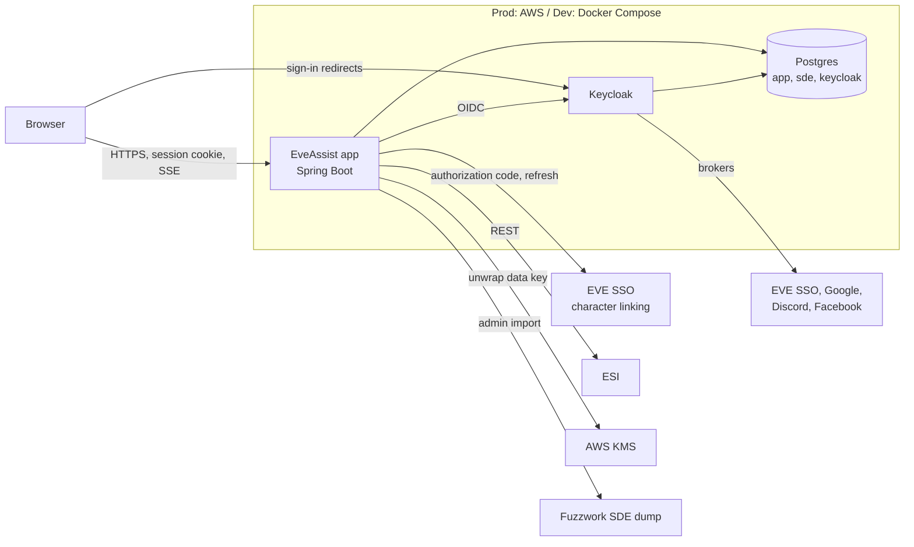

# EveAssist Architecture

Status: draft, interview in progress.

This describes how EveAssist is built to meet the [requirements](../requirements/README.md). The code in `Api/` and
`Client/` is a prototype. It shows which tools work (Spring Boot, Keycloak, Postgres, Thymeleaf with Tailwind and
Alpine, Spring's `RestClient` against ESI, the Fuzzwork SDE dump), but it is not the architecture described here.

Each decision says what was chosen and why. **Agreed** decisions were made with the user. **Proposed** decisions follow
from the agreed ones or are technical details. They stand unless the user changes them, and they are listed for review
under [Open questions](#open-questions).

## Files

- [Identity and ESI tokens](identity-and-tokens.md): sign-in, character linking, token storage and refresh
- [ESI access](esi.md): the ESI client, background fetches, freshness, prices and alerts
- [Data and ownership](data.md): database layout, ownership and sharing, SDE import and versioning
- [Deployment and operations](deployment.md): dev, prod in AWS, backups, secrets and monitoring

## Context

## Decisions at a glance

| Area | Decision | Status |
|---|---|---|
| Module layout | One Spring Boot app with internal modules, recommended; see open questions | Open |
| UI | Thymeleaf with htmx, Alpine and Tailwind, recommended; see open questions | Open |
| Data ownership | Owner column on every personal row, explicit share tables for groups later | Agreed |
| Refresh tokens | AES-256-GCM in the app, data key wrapped by AWS KMS (dev: key from `env.properties`) | Agreed |
| Background fetches | In-process tasks on virtual threads, per-character Postgres advisory lock, fetch state in the database | Agreed |
| SDE | Fuzzwork Postgres dump, loaded into a staging schema, diffed against the live one, then swapped | Agreed |
| Prod in AWS | One EC2 instance with Docker Compose (app and Keycloak), Postgres on RDS | Agreed |
| Alerts | Stored in Postgres, pushed to open pages with server-sent events (SSE) | Agreed |
| Language and framework | Java 25 and Spring Boot 4.1, as in the prototype's `Api/` | Proposed |
| Sessions | Spring Session stored in Postgres | Proposed |
| Character linking | A separate EVE SSO application, called by the app directly, not through Keycloak | Proposed |

## Module layout and UI (open)

These two are decided together and are still under discussion with the user.

The recommendation is one Spring Boot 4.1 / Java 25 application in place of the separate `Api/` and `Client/`, with
module boundaries enforced inside it (for example with Spring Modulith):

| Module | Holds |
|---|---|
| `identity` | Accounts, profile, Keycloak sign-in, admin actions and the audit log |
| `characters` | Linked characters, ESI tokens, scopes and re-authorization state |
| `esi` | The ESI client: caching, rate limits, error limit, pagination |
| `sde` | Read-only access to the SDE and the SDE import |
| `industry` | Blueprints, facilities, plans, costing, projects, invention and job tracking |
| `market` | Prices, orders, wallet transactions, contracts, shopping lists and volumes |
| `alerts` | Stored alerts, the SSE stream, job-finish and contract timers |
| `groups` | Phase 2: groups, membership, group roles and sharing |

Why one app rather than the prototype's two:

- Both would sign in through Keycloak and both would need the database. The Client would only relay calls to the Api.
- One deployable is cheaper to run on one EC2 instance and simpler to keep working across several computers.
- A module can still be split out later, because modules talk only through their public services and events.

For the UI, server-rendered Thymeleaf with htmx (partial page updates and the SSE extension), Alpine and Tailwind is
recommended. Only a session cookie reaches the browser, all code is in one language, and UI text stays in
`messages.properties`. The cost is a round trip per change in the plan editor, and very rich editing would need
hand-written Alpine components. The alternative is a single-page app (Angular or React) served by the same backend,
which acts as a backend-for-frontend so that no tokens are kept in the browser. A hybrid with only the plan editor as a
SPA island is also possible.

Whichever UI is chosen, plan costing and the other domain logic live in services that take and return plain objects,
so that a JSON API can be added later without a rewrite.

## Open questions

- **UI approach and module layout**: Thymeleaf with htmx, a SPA, or a hybrid with the plan editor as a SPA island; and
  whether the Java side becomes one app. The user wants to discuss this interactively before deciding. The same plan
  editor was built in all three candidate stacks (`spikes/ui/` on branch `ui-spikes`). Vaadin was rejected after the
  spikes, because it keeps every open browser tab's UI in server memory, which the user does not consider scalable.
- **Proposed decisions to confirm**: Java 25 and Spring Boot 4.1; Spring Session in Postgres; a separate EVE SSO
  application for character linking; the SDE kept as a schema in the app database; TLS through Caddy on the EC2
  instance rather than a load balancer; deploying images from GitHub Actions. Each is explained in its file.
- **Requirements follow-up**: [ESI access and tokens](../requirements/esi-access.md) asks whether the dashboard waits
  for the fetch after sign-in. This architecture assumes it does not: the dashboard shows stored data while the fetch
  runs in the background and shows its progress, as the performance requirements say for long fetches.
