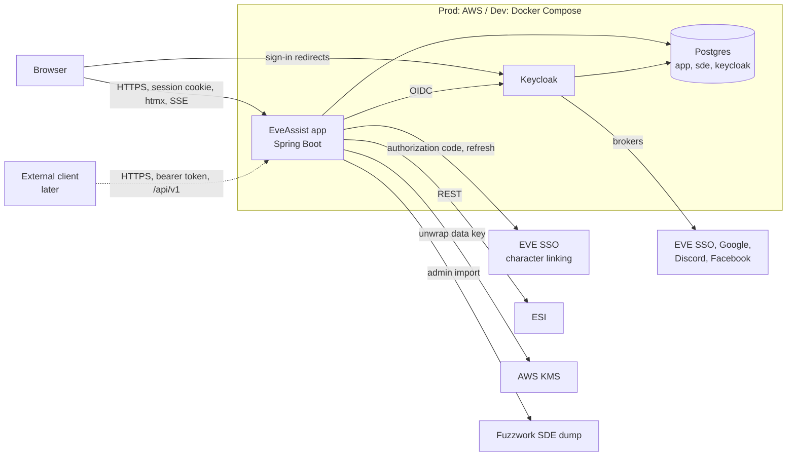

# EveAssist Architecture

Status: draft, interview in progress.

This describes how EveAssist is built to meet the [requirements](../requirements/README.md). The code in `Api/` and
`Client/` is a prototype. It shows which tools work (Spring Boot, Keycloak, Postgres, Thymeleaf with Tailwind and
Alpine, Spring's `RestClient` against ESI, the Fuzzwork SDE dump), but it is not the architecture described here.

Each decision says what was chosen and why. **Agreed** decisions were made with the developer. **Proposed** decisions
follow from the agreed ones or are technical details. They stand unless the developer changes them, and they are listed
for review under [Open questions](#open-questions).

## Files

- [Identity and ESI tokens](identity-and-tokens.md): sign-in, character linking, token storage and refresh
- [ESI access](esi.md): the ESI client, background fetches, freshness, prices and alerts
- [Data and ownership](data.md): database layout, ownership and sharing, SDE import and versioning
- [External REST API](api.md): the API for outside clients and automation, designed now and built later
- [Deployment and operations](deployment.md): dev, prod in AWS, backups, secrets and monitoring

## Context

## Decisions at a glance

| Area | Decision | Status |
|---|---|---|
| Module layout | One new Spring Boot app in a new top-level module, with internal module boundaries; no code taken from `Api/`, `Client/` or `spikes/` | Agreed |
| UI | Server-rendered Thymeleaf with htmx, Tailwind and daisyUI; no React | Agreed |
| Data ownership | Owner column on every personal row, explicit share tables for groups later | Agreed |
| Refresh tokens | AES-256-GCM in the app, data key wrapped by AWS KMS (dev: key from `env.properties`) | Agreed |
| Background fetches | In-process tasks on virtual threads, per-character Postgres advisory lock, fetch state in the database | Agreed |
| SDE | Fuzzwork Postgres dump, loaded into a staging schema, diffed against the live one, then swapped | Agreed |
| Prod in AWS | One EC2 instance with Docker Compose (app and Keycloak), Postgres on RDS | Agreed |
| Alerts | Stored in Postgres, pushed to open pages with server-sent events (SSE) | Agreed |
| External REST API | Designed now, built later; Keycloak OAuth for third-party apps and personal access tokens for scripts; serves stored data only | Agreed |
| Language and framework | Java 25 and Spring Boot 4.1 | Agreed |
| Module folder name | `App/`, beside `Api/` and `Client/` | Agreed |
| Sessions | Spring Session stored in Postgres | Agreed |
| Character linking | A separate EVE SSO application, called by the app directly, not through Keycloak | Agreed |
| SDE location | A schema in the app's database, not a separate database | Agreed |
| TLS and builds | Caddy on the EC2 instance; GitHub Actions builds images into Amazon ECR | Agreed |

## Module layout

Status: **agreed**.

EveAssist is one Spring Boot application, started as a new top-level module, `App/`. It is written from
scratch: nothing is copied or inherited from the prototype in `Api/` and `Client/`, or from the UI spikes in `spikes/`,
so that none of their shortcuts carry over. The prototype stays as reference until the new module covers what it
showed, and is then removed. The UI spikes were never merged: they are kept for reference on branch `ui-spikes`
(pushed to `origin`), and their findings are recorded below.

Why one application rather than the prototype's two: both would sign in through Keycloak and both would need the
database, and the Client would only relay calls to the Api. One deployable is cheaper to run on one EC2 instance and
simpler to keep working across several computers. The htmx pages and the later REST API are two sets of controllers
over the same services.

Module boundaries inside the application are enforced (for example with Spring Modulith):

| Module | Holds |
|---|---|
| `identity` | Accounts, profile, Keycloak sign-in, admin actions and the audit log |
| `characters` | Linked characters, ESI tokens, scopes and re-authorization state |
| `esi` | The ESI client: caching, rate limits, error limit, pagination |
| `sde` | Read-only access to the SDE and the SDE import |
| `industry` | Blueprints, facilities, plans, costing, projects, invention and job tracking |
| `market` | Prices, orders, wallet transactions, contracts, shopping lists and volumes |
| `alerts` | Stored alerts, the SSE stream, job-finish and contract timers |
| `groups` | Phase 2: groups, membership, group roles and sharing |
| `api` | Later: the external REST API's controllers, tokens and rate limits (see [External REST API](api.md)) |

Modules talk only through their public services and events, and those services take and return plain objects, never
pages or JSON.

## UI

Status: **agreed**.

Pages are rendered on the server with Thymeleaf. htmx updates parts of a page (a recalculated plan, a moved job) and
receives alerts and fetch progress over SSE. Styling is Tailwind with daisyUI components, both built with npm by the
Maven build in place of the spikes' CDN links. UI text stays in `messages.properties`. Small pieces of JavaScript are
allowed where a screen needs them, such as drag and drop with SortableJS.

How it was chosen: the same plan editor was built in Thymeleaf with htmx, in React and in Vaadin (`spikes/ui/` on
branch `ui-spikes`), and a drag-and-drop job board was then added to the htmx and React versions.

- Vaadin was rejected because it keeps the UI of every open browser tab in server memory, which the developer does not
  consider scalable. It would also need sticky sessions for a second instance.
- React showed live previews while dragging (the job's duration and the slot count for the character under the
  pointer) and instant moves. It needed a second toolchain, the API types and rules written again in TypeScript, and
  routing of its own. The developer judged that not worth it for EveAssist's screens.
- htmx did everything the screens need, with the results shown after each click or drop.

What the htmx UI must get right, found while building the spikes:

- **Template tests**: every template is rendered in a test with sample data that covers each case (empty lists,
  missing values, rare item kinds), and the test fails on any error or on a missing message key (`??key??`).
  Thymeleaf checks nothing when the code compiles, so these tests are what catch mistakes before production.
- **One shared htmx set-up**, written and tested once: the CSRF header on every request; `HX-Redirect` when the session
  has expired, so the sign-in page is not swapped into a fragment; a visible message on 4xx and 5xx responses;
  `hx-sync` against overlapping requests; loading indicators.
- **Latency**: screens are tried with Chrome's network throttling at 50 ms and 150 ms, which stand for a player near
  the AWS region and one on another continent.
- **Large plans** update only the rows that changed and the totals, not the whole tree.
- **Escaping**: only `th:text` is used for data. `th:utext` is not used for anything a user or ESI supplied.
- **Drag and drop**: the drop target is the whole column, and on drop the column under the pointer decides, not the
  last one the pointer crossed. The server checks every move.

## Open questions

- **Proposed decisions still to review**: the shape of the external API ([External REST API](api.md#shape)). The
  developer chose to keep it proposed until the phase that builds the API is decided, and to review it then.
