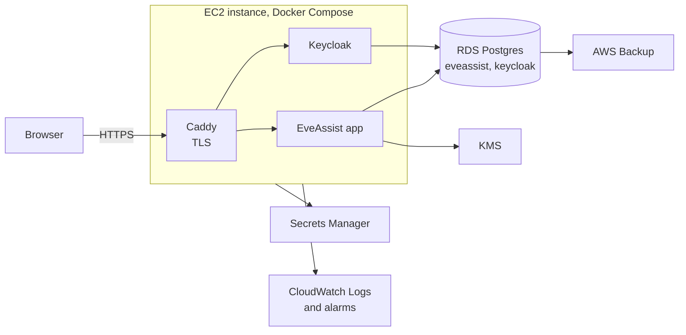

# Deployment and Operations

Status: draft, interview in progress.

Covers [Non-functional requirements](../requirements/non-functional.md).

## Dev

- `Infrastructure/compose.yaml` runs Postgres and Keycloak, as today. The app runs from the IDE or with `./mvnw`
  against them.
- Secrets come from the untracked files described in `CLAUDE.md`. The token data key in dev is a value in
  `env.properties`.

## Prod in AWS

- One small EC2 instance runs the app and Keycloak with Docker Compose, the same shape as dev. The instance size is
  chosen so that both fit with room to spare (Keycloak needs about 1 GB).
- Postgres is RDS, single-AZ, holding the `eveassist` and `keycloak` databases.
- TLS ends at Caddy on the instance, with certificates from Let's Encrypt. That avoids the monthly cost of a load
  balancer until a second instance is needed.
- GitHub Actions builds and tests each push, builds the image and pushes it to Amazon ECR. A deploy pulls the image on
  the instance and restarts the stack. Downtime during a deploy is acceptable.
- ECR was chosen over GitHub's registry because the instance pulls with its IAM role, so no registry credential is kept
  on it. A lifecycle rule keeps the last few images, which costs about $0.10 a month.
- Prod runs at `eveassist.net`. The EVE application callback URLs and the Keycloak redirect URIs use it.

Why this shape: it is cheap for a free tool (roughly $30–45 a month), it matches dev, and RDS takes on the backups and
restores that the requirements ask for.

Status: **agreed**.

## Backups

- RDS automated backups keep seven daily snapshots, with point-in-time recovery in between.
- An AWS Backup plan takes a weekly snapshot and keeps four.
- A restore is tested by restoring a snapshot to a new RDS instance, starting the app against it and checking that it
  signs in and shows data. The steps are written down. The test runs every six months, and again after any change to
  the backup set-up.

## Secrets

- In prod, secrets (database passwords, the Keycloak client secret, the EVE application secrets, the wrapped token data
  key) come from AWS Secrets Manager when the containers start. None are in the images or in git.
- The KMS key that wraps the token data key may be used only by the instance's IAM role.

## Scaling later

The app is ready for a second instance without a rewrite: sessions are in Postgres, per-character work is guarded by
advisory locks, alerts can pass between instances with `LISTEN`/`NOTIFY`, and fetch state is in the database. At that
point a load balancer replaces Caddy and the app may move to ECS. Keycloak can stay on one instance for a while.

## Monitoring

- Container logs go to CloudWatch Logs through Docker's `awslogs` driver. Logging never writes tokens or secrets: the
  token classes have no readable `toString`, and request logging leaves out `Authorization` headers and token bodies.
- The app exposes Spring Boot Actuator health. Keycloak exposes its own health endpoint. Both are checked by the
  Compose health checks and by a CloudWatch alarm.
- CloudWatch metric filters count ERROR log lines and ESI failures (429s, 420s, 5xx). Alarms email the operator when
  either spikes.

## Open questions

None at present.
